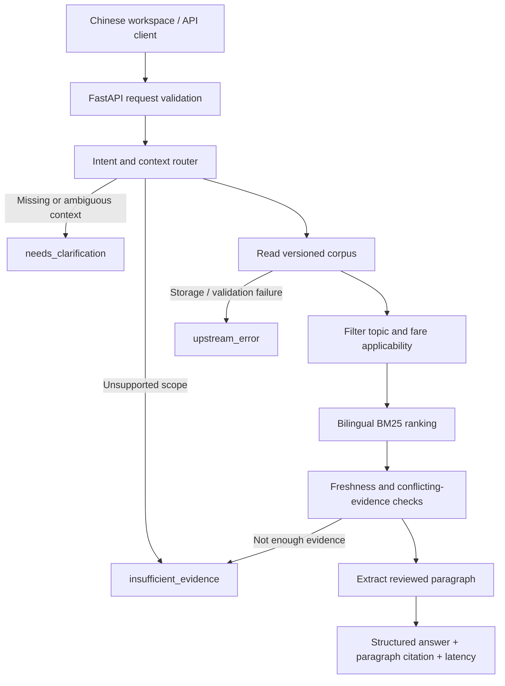

# Travel Operations Knowledge Assistant

A retrieval-augmented assistant for travel support and operations teams. Built with public travel policy documentation, it provides evidence-linked answers, asks for missing context, and explicitly reports insufficient evidence and dependency failures.

**v0.3 adds a real File Search MCP server and client to the Customer Support Agent (客服协助代理) and Code Analyzer subagent (代码分析器).** The parent delegates osTicket repository questions to a separate task interface with read-only structure, search and file-inspection tools. Existing travel-policy questions retain the original evidence checks. The code branch now calls read-only tools over MCP stdio by default; a direct local backend remains available for comparison. Both branches use deterministic orchestration, not LLM reasoning. No model account, API key, vector database or runtime network access is required.

The MCP server reads a local index of the pinned osTicket commit and returns file/line citations, commit identity and an observable agent/tool trace. See [the code-agent guide](docs/code-analyzer.md) for setup, architecture and API examples. The policy branch works even when no repository index is installed. On this workspace, the repository and its 755-file index have already been prepared.

This is an independent portfolio project. It is not affiliated with Peach, Adventure or skyticket, and contains no proprietary procedures, production integrations or former-employer materials.

See [the File Search MCP guide](docs/file-search-mcp.md) for the architecture, actual protocol flow, error contract, external-client configuration and limitations. The MCP process is started automatically for each code analysis. No remote MCP hosting is required.

```text
Customer Support Agent → Code Analyzer → MCP Client
    → stdio JSON-RPC → File Search MCP Server → pinned code index
```

Quick protocol smoke test: `python -m scripts.mcp_smoke`. Compare the same real-repository regressions with `python -m evals.run_code --backend local` and `python -m evals.run_code --backend mcp_stdio`. MCP failures return `upstream_error`; there is no silent local fallback. The demo does not claim lower latency or token savings.


## Offline retrieval improvements (v0.4)

Code evidence now retains the actual status-code hit and attempts to return a complete enclosing PHP function/class. Oversized declarations are explicitly marked partial; unsupported syntax uses a bounded line window. Every snippet preserves exact indexed text and pinned line citations. This is conservative lexical analysis, not a PHP parser or an LLM.

See [the offline demo and evaluation guide](docs/offline-demo.md). The 20-case code regression includes evidence/range checks; the MCP run additionally compares its complete domain results against the direct local backend. Tests remain runnable without model credentials.

## Run locally

Python **3.12** is the tested interpreter. Run commands from this directory. On Windows, avoid an older Anaconda `python` by using `py -3.12` and the explicit virtual-environment interpreter:

```powershell
py -3.12 -m venv .venv
.\.venv\Scripts\python.exe -m pip install -r requirements.lock
.\.venv\Scripts\python.exe -m uvicorn app.main:app --host 127.0.0.1 --port 8000 --log-config logging.json
```

If this workspace has already been set up, only the final command is needed. Alternatively, run `./start.ps1` if your PowerShell execution policy allows local scripts.

On macOS/Linux:

```bash
python3.12 -m venv .venv
.venv/bin/python -m pip install -r requirements.lock
.venv/bin/python -m uvicorn app.main:app --host 127.0.0.1 --port 8000 --log-config logging.json
```

Open [the workspace](http://127.0.0.1:8000), [API documentation](http://127.0.0.1:8000/docs), or [health status](http://127.0.0.1:8000/health). Stop with Ctrl+C. Swagger UI loads its upstream assets from a CDN; the actual workspace does not use a CDN.

`requirements.lock` pins the environment used for validation, including test dependencies. `pyproject.toml` records compatible top-level dependency ranges. No `.env` file is required or automatically loaded.

## Try the behavior

| Question / context | Expected behavior |
| --- | --- |
| `Peach 的手提行李有什么重量和件数限制？` | Answer with the carry-on policy paragraph and source |
| `Peach 可以改签吗？` | Ask for fare type, reason and booking channel |
| Same question with `standard_plus`, `voluntary`, `direct` | Answer with the applicable change-policy summary |
| `Peach 航班被取消，能退款吗？` | Insufficient evidence: disruption rules are outside this corpus |
| `Peach 充电宝可以放在手提行李吗？` | Insufficient evidence: special-item policy is not included |
| Unavailable or invalid knowledge file | Structured `upstream_error` and HTTP 503 for a query that needs retrieval |

The UI remembers the current form only. Clarification is **stateless**: edit the original question or its context and resubmit. It does not remember a conversation or accept an isolated follow-up such as “Standard”.

## Scope and provenance

The corpus has **11 policy paragraphs from 5 official Peach pages**, manually checked on **2026-10-26**. It covers general carry-on limits, checked-baggage limits and included allowance, and voluntary cancellation/change policies for the current Minimum, Standard and Standard Plus fare families. Cancellation and change answers require a confirmed direct booking channel. Answers are generic policy summaries, never a determination about a specific ticket.

Source pages:

- [Carry-on baggage](https://www.flypeach.com/en/lm/ai/airports/baggage/carry_on_bag)
- [Checked baggage](https://www.flypeach.com/en/lm/ai/airports/baggage/checked_in_bag)
- [Fare types](https://www.flypeach.com/en/lm/fares/fare_type)
- [Changes, cancellations and refunds](https://www.flypeach.com/en/lm/fares/fare_conditions)
- [Booking change deadline FAQ](https://cs.flypeach.com/hc/en-us/articles/4659210429086-When-is-the-deadline-for-booking-changes)

The repository stores concise **curated paraphrases**, not scraped copies or purported original quotations. Every paragraph has a stable ID, official URL, source section, review date, topic and fare applicability. `corpus_sha256` hashes the exact local JSON bytes, **not** the original website. Review date is not a policy effective date.

The application checks freshness against the current date in Japan. A review window of **30 days** is a project quality rule, not an airline policy. Future review dates and out-of-window evidence are rejected. Nothing refreshes automatically. See [the corpus review procedure](docs/knowledge-maintenance.md).

Not covered: precise fees/refund calculations, booking transactions, OTA-specific handling, disruption entitlements, historical/future applicability, unusual baggage, passenger-specific eligibility, internal APIs or live flight status. The system uses no traveller records.

## API contract

```http
POST /ask
Content-Type: application/json
```

```json
{
  "question": "Standard Plus 因个人原因改签，官网办理需要手续费吗？",
  "context": {
    "airline": "peach",
    "fare_type": "standard_plus",
    "reason": "voluntary",
    "booking_channel": "direct"
  }
}
```

The response contains `status`, `answer`, `claims`, `sources`, `clarifying_questions`, `reason_code`, `message`, resolved `context`, `scope`, `mode`, `latency_ms`, `request_id`, and corpus version/hash when retrieval was attempted. Each claim references a source `chunk_id`. Each source contains its official URL, section and explicitly labeled Chinese paraphrase. The API does not expose uncalibrated model confidence.

| Status | Meaning | HTTP |
| --- | --- | --- |
| `answered` | A reviewed paragraph matches the supported topic and supplied conditions | 200 |
| `needs_clarification` | Missing, conflicting or ambiguous user context | 200 |
| `insufficient_evidence` | Uncovered scope, missing evidence, stale evidence or conflicting paragraphs | 200 |
| `upstream_error` | Required knowledge storage cannot be read or validated | 503 |

Invalid request syntax/fields return normal FastAPI 422 validation responses; these are transport validation errors, not the four domain statuses. Unknown fields and invalid enum values are rejected. Questions are limited to 1,500 characters. The offline dependency is the knowledge store; there is no external model outage in this version.

Other routes: `GET /health` (storage and freshness), `GET /knowledge` (source catalog), `GET /docs`, and `GET /openapi.json`.

In v0.2, `/ask` also accepts `task` (`auto`, `travel_policy`, `code_analysis`), optional `repository` and `file_path`. Code results use `mode: static_code_analysis`, `delegated_to: 代码分析器`, and commit-pinned code citations. `GET /agents` describes the main/subagent tools; `GET /repositories` reports index readiness. `GET /health` retains policy readiness and exposes `app_version` to help diagnose stale running processes. The diagram below describes the policy branch; the complete delegation diagram is in the code-agent guide.

## Architecture



The router has explicit controlled vocabulary and exclusions. BM25 uses Chinese character bigrams and English tokens; topic aliases improve recall. Metadata filtering happens before ranking. A rank score is not answer confidence. The corpus allows one fact group per `(topic, fare_type)`; different candidate paragraph texts in that group cause a conservative conflict refusal, not semantic contradiction analysis.

In policy extractive mode, the answer and claim are the exact reviewed local paragraph. This prevents additional generated assertions, but **does not prove that the curator's paraphrase is correct**. Source verification remains manual. There is no LLM entailment validator or autonomous planning. The code subagent executes only its local read-only indexing/search tools, never repository programs or arbitrary shell commands.

## Tests and evaluation

```powershell
.\.venv\Scripts\python.exe -m pytest -q
.\.venv\Scripts\python.exe -m evals.run
```

The suite covers routing, the API contract, actual unreadable storage, corrupt source metadata, freshness boundaries, conflicting facts, context repair and traceable claims. The 40-case regression set contains 13 answer cases, 11 clarification cases, 15 insufficient-evidence cases and 1 storage-failure case. Fault injection is available only in evaluation code, not a public API parameter.

Initial validation: **63 tests passed; 36/36 regression cases passed** on Windows / Python 3.12. Browser checks exercised answer, clarification, scope refusal, catalog navigation and the JSON view. The locked Starlette version emits one deprecation warning for the HTTPX-based TestClient; tests currently pass. CI configuration is included but has not run on GitHub yet.

Follow-up validation (2026-10-27): **77 tests passed; 40/40 regression cases passed** after adding four conversational challenge prompts and contextual tests. The router now recognizes limited colloquial ticket-refund/rescheduling expressions and explicitly asks to verify conflicting passenger and ticket-record fare reports. It does not infer a fare family from “cheapest” or a voluntary reason from “not travelling”. The [follow-up baseline](evals/paraphrase-baseline.json) preserves the new case hash separately from the initial baseline. These prompts are now development cases, not held-out evaluation.

The evaluator writes ignored `evals/latest.json` and exits non-zero on regression. [The checked-in baseline](evals/baseline.json) records the initial run, corpus hash and case-set hash. It measures status accuracy, expected citation IDs, required answer content, unlinked assertions, unsupported-answer rate and in-process latency. It freezes the date to 2026-10-26 to keep regression checks reproducible; production freshness checks always use the actual current date.

These are **hand-authored development regressions**, not a held-out benchmark or human-rated semantic evaluation. A perfect score on this set does not imply perfect natural-language understanding. New paraphrases, negation and compound requests can exceed the rule-based router's coverage. The API returns a generic scope notice even for answered requests. Add independently written challenge cases before making broader reliability claims.

v0.2 validation: **132 tests, 40 policy regressions and 12 real-repository code regressions passed**. The code integration evaluator is `python -m evals.run_code` and requires the prepared local index. Default CI uses synthetic code fixtures and needs no repository download. The [code baseline](evals/code-baseline.json) records the real commit and matching file results.

## Repository map

```text
app/
  main.py          FastAPI app and local web UI
  models.py        Request / response contract
  router.py        Scope, intent and condition checks
  knowledge.py     Validated corpus and lexical retrieval
  service.py       Evidence checks, extraction and telemetry
  static/          Dependency-free Chinese interface
knowledge/         Versioned public-source summaries
evals/             Regression cases, runner and baseline
tests/             API and behavioral tests
docs/              Maintenance and Chinese getting-started guide
```

Logs include request ID, status, reason, latency and corpus version, not questions or traveller details. Routine access logging is disabled by the supplied configuration. No retries are used for deterministic local-file failures. When an external model is added, retries should be bounded to transient failures with explicit timeouts and tested failure mapping.

## Next milestones

1. Expand an independently authored challenge set and improve scope/negation handling.
2. Add a model adapter behind the existing response contract; retain evidence gates and add post-generation claim checks. Keep the free extractive mode.
3. Add reviewed source refresh/diff tooling and release checks.
4. Publish the repository to GitHub after reviewing its contents. Keep keys out of Git; `.env` and `.venv` are ignored.
5. Deploy the FastAPI service and UI together after adding request limits, authentication where needed and dependency review. GitHub Pages alone cannot run this Python backend.

The default server binds only to `127.0.0.1`. This version is a local demo with no authentication, durable sessions or public deployment configuration.
