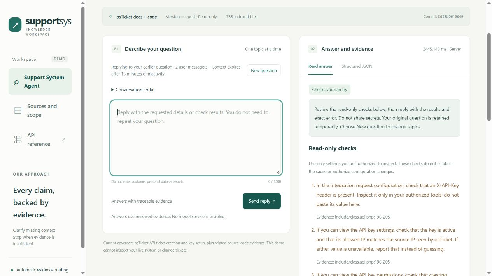
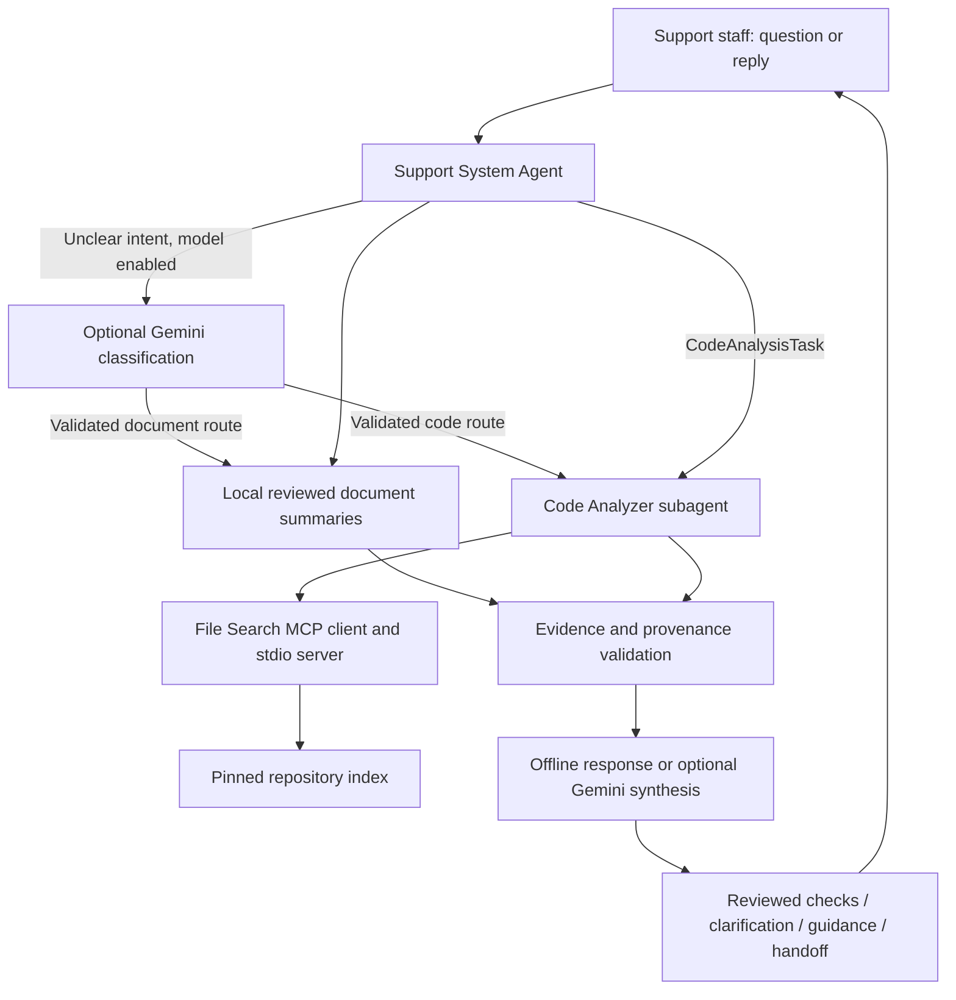

# Support System Knowledge Agent

An English-language assistant for customer support staff investigating osTicket questions. It searches public documentation and source code, returns traceable evidence, asks for missing context, and offers reviewed checks before preparing an engineering handoff. Engineers can also use the cited excerpts to start an investigation.

**Run the complete offline demo without a model key.** Optional Gemini adapters add intent classification and evidence-based answer synthesis. The project demonstrates a support workflow, real MCP integration and explicit failure handling; it cannot inspect or modify a live osTicket installation.

**Current version: v0.12.0** · Python 3.12 · FastAPI · MCP over stdio · Optional Gemini

[Quickstart](docs/quickstart.md) · [Three-minute demo](docs/offline-demo.md) · [API contract](docs/api.md) · [Validation](docs/validation-v012.json)



## The support workflow

Support staff should not need to choose a repository, retrieval scope or model. They ask a question and reply with any missing information.

| User input | System behavior |
|---|---|
| `it occurs a 401 error` | Asks where the error occurred; no retrieval or model call yet |
| `when creating a ticket through the API` | Restores the original question, retrieves code through MCP, and offers three cited read-only checks |
| `I checked all three, but it still returns 401.` | Prepares a local handoff containing the conversation, checks and evidence |
| Alternatively, `It works now.` | Closes as **user-reported resolution**, not a verified fix |

The reviewed checks cover the API key header, key activity/source IP and ticket-creation permission. They apply only when both reviewed excerpts match the pinned code snapshot. Other incidents may still require engineering review. Check-result replies use cached evidence and deterministic rules without another model call.

For a demo, use synthetic reports. In real use, report only checks actually performed and omit customer data and secrets. See the [walkthrough](docs/offline-demo.md) for the full sequence and additional examples.

## Run locally

Requirements: **Python 3.12 and Git**. Open a terminal at the root of this repository. Initial installation and the osTicket download require network access; subsequent offline queries use local data.

```powershell
py -3.12 -m venv .venv
.\.venv\Scripts\python.exe -m pip install -r requirements.lock
git clone https://github.com/osTicket/osTicket.git data/repos/osticket
.\.venv\Scripts\python.exe -m scripts.index_repository
.\.venv\Scripts\python.exe -m scripts.mcp_smoke
$env:ENABLE_GEMINI = '0'
$env:CODE_SEARCH_BACKEND = 'mcp_stdio'
.\.venv\Scripts\python.exe -m uvicorn app.main:app --host 127.0.0.1 --port 8000 --log-config logging.json
```

Open [the workspace](http://127.0.0.1:8000/) or [interactive API docs](http://127.0.0.1:8000/docs). The UI footer and `/health` show v0.12.0. If dependencies and the index already exist, only start the server. Do not clone over an existing directory. [Linux/macOS commands and troubleshooting](docs/quickstart.md) are also provided.

The indexer reads Git blobs at commit `8d38b0619649a50ee7cbbf37085f5d297fdc6f36`, never executes osTicket, and does not depend on its working-tree checkout. The snapshot contains 755 indexed files; vendor, binary and oversized content is excluded. The external clone and generated index live under ignored `data/`. The local folder may retain the historical name `travel-ops-knowledge-agent`.

## Architecture and responsibilities



| Component | Responsibility | Implementation |
|---|---|---|
| Support System Agent | Scope checks, routing, delegation and handoff decisions | [customer_support.py](app/agents/customer_support.py) |
| Code Analyzer | Bounded file, identifier and topic retrieval; line-level citations | [code_analyzer.py](app/agents/code_analyzer.py) |
| File Search MCP | Real `initialize`, `tools/list` and `tools/call`; four read-only tools | [MCP contract](docs/file-search-mcp.md) |
| Document retrieval | Topic/version matching against six reviewed summaries | [Corpus design](docs/documentation.md) |
| Gemini adapters | Optional structured classification and cited answer synthesis | [Gemini guide](docs/gemini.md) |
| Support checks and memory | Evidence-gated steps, outcome handling and bounded reply context | [support_checks.py](app/support_checks.py), [conversation.py](app/conversation.py) |

**The agents use application-controlled orchestration.** The Code Analyzer is a separately invoked task component, not a second LLM. Retrieval is lexical and rule-based, not vector search. Gemini can select an allowlisted route and synthesize evidence; it does not plan tool calls, execute code or search an arbitrary repository. Offline mode demonstrates the entire retrieval and support workflow. With Gemini enabled, retrieved evidence supplies the generation context.

## Optional Gemini

The adapter is ready for an operator-provided API key. On Windows, run `./start-gemini.ps1` and follow its local hidden-input prompt. It is configured for `gemini-3.5-flash-lite`; the adapter supports `GEMINI_MODEL`. Provider access, availability and billing entitlement depend on the operator's account. The launcher asks for a Free Tier confirmation but cannot verify it.

Keys stay server-side. `.env.example` is a template; `.env` is **not** automatically loaded. Startup and health checks make no model calls. Questions, bounded clarification context and selected evidence may be sent to Google when enabled. Requests have deadlines and input/output limits, with no automatic model retries or paid-model fallback.

```powershell
# Dry run: no key read and no model request
.\.venv\Scripts\python.exe -m scripts.try_gemini
```

See [setup, opt-in live testing and failure behavior](docs/gemini.md). Limited live synthesis smoke tests have succeeded; general answer quality and intent-classifier quality remain unevaluated. This demo has no authentication or global spending quota: keep the server on localhost.

## Response contract

`POST /ask` accepts `{"question":"Which fields are required to create a ticket through the API?"}`. The UI selects behavior automatically. Developer overrides and complete field definitions are in the [API contract](docs/api.md).

| Status | Meaning |
|---|---|
| `answered` | Evidence supports an answer or code location; this does not mean the incident is resolved |
| `needs_clarification` | More context is needed |
| `insufficient_evidence` | Available sources do not cover the question |
| `upstream_error` | Retrieval or generation failed; no fabricated fallback answer |

`resolution` identifies guidance, pending checks, user-reported resolution or the need for additional help. Each `support_checks` item has citation IDs. When `conversation.state=awaiting_reply`, send the next message with the returned `clarification_id`, including when the status is `answered`. Handoffs are downloadable and never sent automatically.

## Validation

| Check | Recorded result |
|---|---|
| Unit and integration tests | 228 passed |
| Support development regressions, real MCP | 18/18 |
| Code development regressions, real MCP | 20/20, including local/MCP parity |
| Offline browser walkthrough | Clarification, checks, handoff, reset and user-reported closure verified |
| Gemini for v0.12 changes | Mocked integration; zero live model calls for this release |

See the [v0.12 validation record](docs/validation-v012.json) and [publication preparation record](docs/publication.md). These are self-authored development regressions, not held-out accuracy benchmarks. Citation-ID validation does not prove semantic support. Earlier results remain in the [project history](docs/history.md).

```powershell
.\.venv\Scripts\python.exe -m pytest -q
.\.venv\Scripts\python.exe -m evals.run_support --backend mcp_stdio
.\.venv\Scripts\python.exe -m evals.run_code --backend mcp_stdio
```

Unit tests use synthetic fixtures and mocked Gemini transport; no key is required. The two regression runners need the pinned code index. A Starlette TestClient/httpx deprecation warning currently appears.

## Current boundaries

- **Knowledge:** three official v1.17.7 API documentation pages and one pinned public repository. Documentation/code version equivalence is unverified. No travel policies or general support-procedure coverage.
- **Checks:** one reviewed API ticket-creation 401 playbook. No automatic setting changes, ticket operations or runtime diagnosis. Outcome handling uses a small deterministic vocabulary.
- **Memory:** one process, up to 128 pending conversations, 15 minutes of inactivity, four user turns and 6,000 composed user characters. Refresh loses the browser reference; restart clears server memory. Use **New question** to change topics.
- **Deployment:** a local portfolio demo with no authentication, shared session store or production hosting. Publishing the repository does not deploy the application.

This project is independent of osTicket and any travel company. Public source ownership and attribution are documented in [Third-party notices](THIRD_PARTY_NOTICES.md). A reuse license for this project's original code has not yet been selected.
