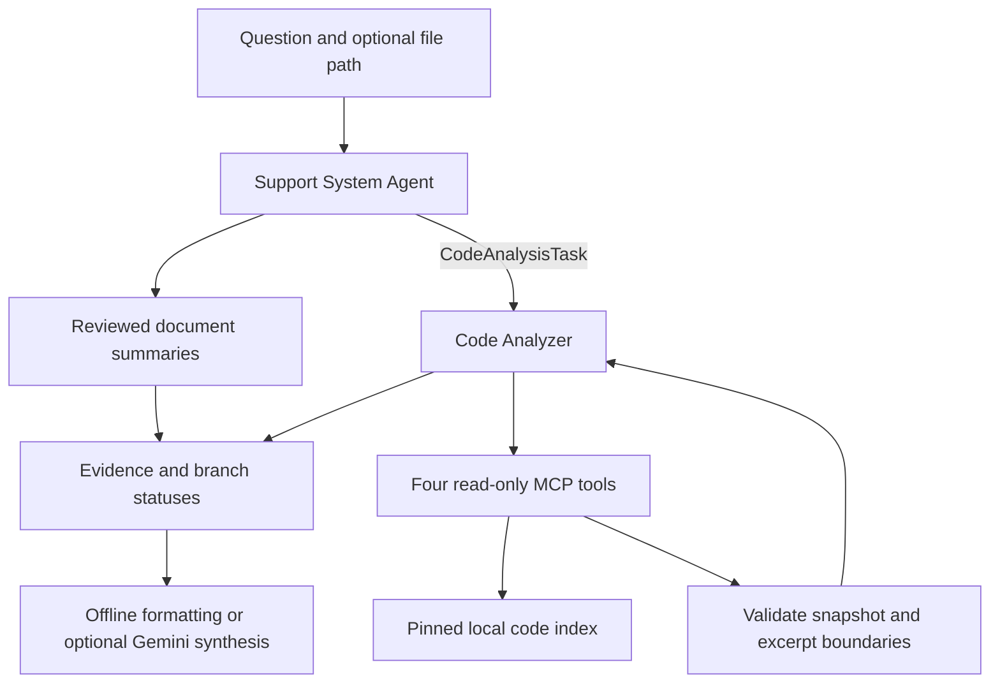

# Main agent and Code Analyzer

The main **Support System Agent** performs scope validation and rules-first routing, with optional Gemini classification when intent remains unclear. It delegates a separate `CodeAnalysisTask(question, repository, file_path)` to the **Code Analyzer**. This subagent uses deterministic orchestration, not its own LLM.



## Deterministic task orchestration

English intent cues select an overview, a specific file, or identifier/topic retrieval. Explicit camelCase or snake_case identifiers take priority over general words and concept aliases. Unknown explicit symbols do not fall back to loosely related generic matches. Exact status-code queries require that code in the matching file and visible excerpt.

This is bounded lexical retrieval, not arbitrary source-code understanding or an inferred runtime call graph. The subagent cannot execute PHP, modify the target repository or access arbitrary repositories. The optional Gemini layer runs afterward and does not plan tool calls.

Web defaults to `mcp_stdio`. Direct Python `CodeAnalyzerAgent()` defaults to `local`; both share the engine. See [MCP contract](file-search-mcp.md).

## Requests and evidence

```json
{"question":"Inspect the entry point in this file","file_path":"scp/login.php"}
```

`POST /ask` requires a question. `task` can select automatic, documentation, code or combined retrieval. File paths are repository-relative. The repository URL is allowlisted. Document version requests never change the code commit.

Code answers use `mode=static_code_analysis`; other modes are `documentation`, `combined` and `routing`. Uncertain routing can use the optional classifier; clarification outcomes stop before evidence retrieval. The Web API retains bounded pending clarification and support-check context; direct Python/CLI calls remain stateless. Travel topics return `outside_project_scope`; mixed travel/code questions return `mixed_scope` before MCP is called.

Each source contains an exact excerpt, commit, file, line range and context classification. `complete_symbol` means a lexical declaration boundary was fully displayed, not that all business context is included. Ambiguous syntax uses a line window. Symbol excerpts are limited to 80 lines / 12,000 characters; line windows to 24 lines.

## Source integrity

The indexer reads Git blobs at the commit pinned in `knowledge/repositories.json`, independent of working-tree edits. It excludes unsupported, binary, oversized and selected vendor content. An absent indexed file may still exist upstream. Index building, Git fetching and application queries are separate operations. Original third-party code is never translated: exact evidence and line references must remain intact.
