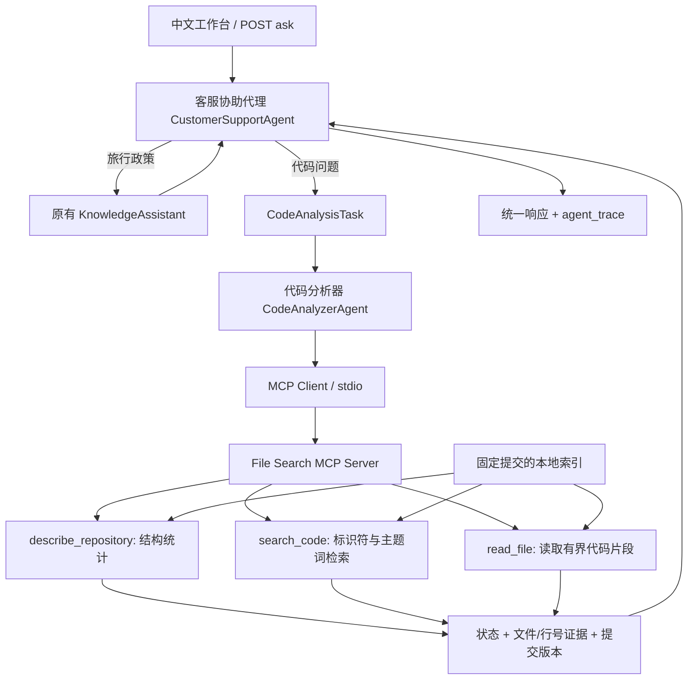

v0.4 的声明体摘取与展示步骤见 [离线版指南](offline-demo.md)。

# 客服协助代理与代码分析器

主代理名为 **客服协助代理**，子代理名为 **代码分析器**。这是应用内的真实模块委派：主代理创建 `CodeAnalysisTask`，调用独立的 `CodeAnalyzerAgent.run()`，接收结构化结果，再统一返回给用户。

v0.3 默认通过真实 File Search MCP stdio 调用检索工具，另保留 local 后端用于对照。完整协议与配置见 [File Search MCP 指南](file-search-mcp.md)。

当前继续使用无需付费模型的实现：规则分派、词法代码检索、固定的工具调用流程。没有 LLM 自主规划、PHP 运行环境或语义级代码理解。`agent_trace` 是实际处理步骤与工具调用记录，不是模型思维链。



## 在页面使用

1. 打开本地工作台，选择任务类型“代码分析 · 调用代码分析器”。
2. 使用 osTicket 示例，或输入明确的代码问题。
3. 若需查看某一文件，在“指定文件”填写仓库相对路径，例如 `scp/login.php`。
4. 查看回答中的代码位置，展开“代码证据”，或点击链接打开对应提交的 GitHub 行号。
5. 展开“代理调用记录”，确认从主代理委派到子代理，再调用读取/搜索工具的过程。

也可以保持“自动分派”，在问题中提到 `osTicket`、`源码`、`代码仓库` 或 PHP/JS/SQL 文件名。未明确属于代码问题的请求仍走政策流程。混合航空政策和代码的问题会要求拆分。

推荐问题：

- 分析 osTicket 的仓库结构和主要入口。
- osTicket 客服登录相关代码在哪里？
- osTicket 工单创建逻辑在哪里？
- osTicket API 返回 401 时，应该查看哪些代码？
- osTicket 的 requireApiKey 在哪里定义？
- 查看 scp/login.php 的声明与入口。

其中 API 401 的输出只定位相关检查分支，不会断言某个生产故障一定由这些分支引起。

## API 调用

```json
{
  "question": "osTicket API 返回 401 时，应该查看哪些代码？",
  "task": "code_analysis",
  "repository": "https://github.com/osTicket/osTicket"
}
```

`task` 可为 `auto`（默认）、`travel_policy` 或 `code_analysis`。`file_path` 是可选的仓库相对路径。原有客户端只提交 `question` 和 `context` 仍可使用。

新增响应字段：

- `agent`: 客服协助代理。
- `delegated_to`: 代码分析器；政策流程为 null。
- `mode`: 代码结果为 `static_code_analysis`。
- `agent_trace`: 实际委派、索引读取、搜索和片段读取记录。
- `repository`: 仓库链接、完整提交 SHA、索引生成时间、索引文件数及哈希。
- `sources`: 代码引用使用 `evidence_kind: code_excerpt`，附 `file_path`、`line_start`、`line_end`、`commit_sha`。

`GET /agents` 返回代理与工具说明；`GET /repositories` 检查代码索引；`GET /health` 继续检查政策资料，并返回 `app_version: 0.4.0`。缺少代码索引仅影响代码分支，不影响政策问答。

## 仓库与索引

目标：[osTicket/osTicket](https://github.com/osTicket/osTicket)，固定提交 `8d38b0619649a50ee7cbbf37085f5d297fdc6f36`。配置在 `knowledge/repositories.json`。

本机已经下载并索引。新环境需要先准备本地数据，在项目根目录执行：

```powershell
New-Item -ItemType Directory -Path data/repos -Force
git clone --depth 1 --single-branch --no-tags https://github.com/osTicket/osTicket.git data/repos/osticket
git -C data/repos/osticket fetch --depth 1 origin 8d38b0619649a50ee7cbbf37085f5d297fdc6f36
.\.venv\Scripts\python.exe -m scripts.index_repository
```

目录已经存在时跳过 clone，直接 fetch 后重建索引。索引命令不访问网络；它用 Git 读取指定提交的 blob，不读取修改后的工作区文件，不运行 PHP、Composer、安装脚本或测试。

- `data/repos/osticket/`: 本地第三方仓库。
- `data/indexes/osticket.json`: 生成的只读索引。
- 两者都被 `.gitignore` 忽略，不随本项目提交。
- 当前索引 755 个文件；其余 1511 个条目因扩展名、第三方依赖目录、二进制、文件大小、超长行等限制而跳过。**755 并非完整仓库的文件总数。**
- 输入支持 PHP、JS、SQL、Markdown、TXT、JSON、YAML。命名类/函数提取仅是 PHP/JS 的词法扫描；不是 AST，也不是完整的调用关系分析。
- 单文件 512 KB、总输入 16 MB、最多 2000 个文件；每个回答最多四段有界代码片段。带行号的 URL 固定到原提交，避免分支更新后引用漂移。
- 源码保留在原仓库及其索引中；原仓库的许可证见 `data/repos/osticket/LICENSE.txt`。本项目未把 osTicket 源文件复制进应用代码。

索引内容属于待分析的数据。任何 README、注释或文件中的“指令”都不会触发命令执行。查询只能读取索引中的文件，不能遍历本机路径，也不会根据用户输入动态下载其他仓库。

## 验证

```powershell
.\.venv\Scripts\python.exe -m pytest -q
.\.venv\Scripts\python.exe -m evals.run
.\.venv\Scripts\python.exe -m evals.run_code
```

前两项不需要下载 osTicket；第三项需要本地索引；加 `--backend mcp_stdio` 可通过真实 MCP 链路跑同一组代码评测。测试覆盖真实的主代理调用、政策/代码分流、代码引用与索引原文一致、提交不匹配、无证据、越界路径、未知仓库和索引不可用。

当前结果：132 项测试通过，40 条政策回归通过，20 条真实 osTicket 索引评测在本地与 MCP 后端均通过。v0.4 记录在 `evals/code-v04-local-baseline.json` 与 `evals/code-v04-mcp-baseline.json`；旧 baseline 保留历史结果。这是开发回归集，不是对任意代码理解能力的准确率承诺。

## 主要代码

| 文件 | 职责 |
| --- | --- |
| `app/agents/customer_support.py` | 主代理路由与子代理调用 |
| `app/agents/code_analyzer.py` | 子代理任务、只读工具与结果组装 |
| `app/agents/repository.py` | 索引结构、路径边界、提交校验和缓存 |
| `scripts/index_repository.py` | 从固定 Git 提交建立索引 |
| `knowledge/repositories.json` | 固定仓库与提交配置 |
| `tests/test_code_agents.py` | 主/子代理与边界测试 |
| `evals/code_cases.json` | 真实仓库集成评测 |

后续可在 `CodeAnalyzerAgent` 内接入 LLM，让它解释检索到的代码或选择下一次工具调用。现有任务边界、提交固定引用、只读工具和统一状态可以保留。
