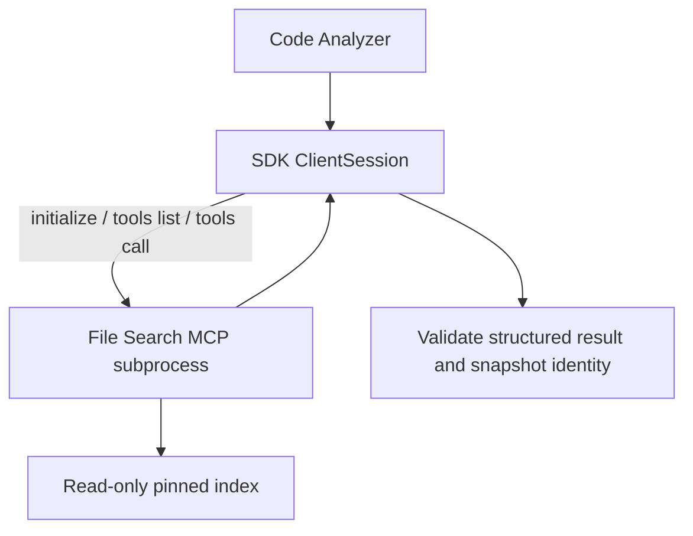

# File Search MCP engineering demo

The Code Analyzer and search service communicate through **real MCP over stdio** using the official Python SDK. This is not a mocked protocol or hosted file-search product. Local MCP retrieval needs no model key and does not upload source code. Optional Gemini synthesis separately sends selected excerpts only after the operator enables the model service.



## Run and inspect

```powershell
.\.venv\Scripts\python.exe -m scripts.mcp_smoke
.\.venv\Scripts\python.exe -m uvicorn app.main:app --host 127.0.0.1 --port 8000 --log-config logging.json
```

Prepare the index using the [quickstart](quickstart.md). Web defaults to `CODE_SEARCH_BACKEND=mcp_stdio`; the app starts and closes subprocesses automatically. No separate terminal server is needed.

Ask: **Which code should I inspect when the osTicket API returns 401?** The response should show `retrieval_backend=mcp_stdio`, pinned GitHub citations, and trace entries for `mcp.initialize+tools/list`, `mcp.tools/call:search_code` and `mcp.tools/call:read_file`. `/agents` describes configuration; `/repositories` and `/health` actually probe retrieval readiness.

## Tool contract

| Tool | Input | Output and bounds |
|---|---|---|
| `describe_repository` | None | Commit, index hash, file count, directory/language counts |
| `search_code` | `terms`, `limit`, optional `preferred_paths` | 1–10 terms, at most 100 characters each; default 4, maximum 10 file hits with metadata and matched lines |
| `get_file_info` | `path`, optional `anchor` | Language, line count, up to 8 declarations, entry line and optional literal anchor line |
| `read_file` | `path`, `line`, `limit`, `mode` | `lines`: at most 24 lines; `symbol`: at most 80 lines / 12,000 characters, with completeness metadata and pinned URL |

Index lines are limited to 2,000 characters. The client caps each structured result at 250 KB. Trace sizes are characters, not tokens; SDK compatibility text adds protocol bytes. The client never receives all 755 indexed file bodies. The server reads only the configured index and enforces path/allowlist checks. Git fetch, index building, command execution and file writing are not tools.

## Reliability and errors

Business results use `CallToolResult.structuredContent`; compatibility `content` repeats the JSON, but the client parses only the structured result.

```json
{"is_error":false,"error_type":null,"retryable":false,"data":{"hits":[]},"commit_sha":"<pinned commit>","index_sha256":"<index hash>"}
```

- Empty hits are a successful search with insufficient evidence, not a transport error.
- Business errors set both MCP `isError` and structured `is_error`. SDK validation errors may expose only `isError`; the client handles both.
- Connection errors and timeouts return `upstream_error`, with no silent local fallback.
- Protocol calls have a 5-second timeout and the analysis flow a 25-second deadline. Transient transport errors may rebuild the read-only session once. Cleanup can add a small delay.
- Retries restart the read-only analysis; partial answers are not retained. Snapshot commit and index hash are validated across the session.
- Logs go to stderr and contain tool/status/timing metadata, not questions or complete source text. Stdout is reserved for JSON-RPC. Gemini credentials are not forwarded to the MCP child.

## Other MCP clients

Example client configuration; replace paths with actual absolute paths and adapt to the client format:

```json
{"mcpServers":{"support-system-file-search":{"command":"C:/path/to/project/.venv/Scripts/python.exe","args":["-m","app.mcp_server"],"cwd":"C:/path/to/project","env":{"PYTHONUTF8":"1"}}}}
```

Use `.venv/bin/python` on Linux/macOS. `FILE_SEARCH_INDEX_PATH` and `FILE_SEARCH_COMMIT` are administrator/test startup settings, not query parameters. Running the server directly waits on stdin; it is not an HTTP website. Official SDK protocol behavior is tested; compatibility with every third-party client is not claimed.

## Validation and tradeoffs

```powershell
.\.venv\Scripts\python.exe -m pytest -q
.\.venv\Scripts\python.exe -m evals.run_code --backend local
.\.venv\Scripts\python.exe -m evals.run_code --backend mcp_stdio
```

Synthetic fixtures test real subprocess discovery, reads, empty results, invalid paths and parameter bounds; injected failures test disconnects, timeouts and malformed results. Real-index regressions test 20 English cases and local/MCP parity. They are development tests, not independent code-understanding benchmarks. Reports go to ignored `evals/code-latest.json` and `evals/code-mcp-latest.json`.

The SDK dependency is `mcp>=1.28,<2`, locked at 1.30.0. Each request owns one subprocess/session, sharing the parsed index within that request. There is no cross-request process pool/cache, remote HTTP transport, authentication or multi-tenancy. No retrieval speedup or token saving is claimed. `.env` is not auto-loaded; choose `CODE_SEARCH_BACKEND=local` and restart for direct-backend comparison.

Reference: [official MCP Python SDK v1 documentation](https://py.sdk.modelcontextprotocol.io/v1/).
