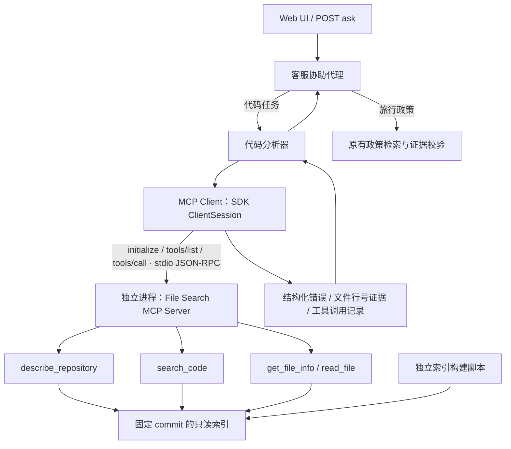
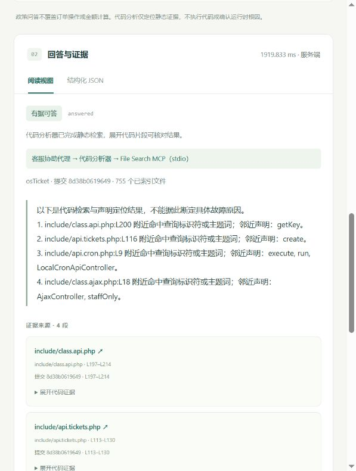

# File Search MCP 工程演示

v0.3 引入 MCP；v0.4 增加有界声明体读取，详见 [离线版指南](offline-demo.md)。

项目把代码分析器与文件检索服务通过 **真实 MCP stdio 连接**分离。主代理和子代理仍由确定性程序编排，不需要 LLM/API Key。MCP 是工具协议；这里没有使用 OpenAI 托管 File Search，也没有上传代码到第三方服务。



## 本地运行

在项目根目录执行，先按 [代码分析指南](code-analyzer.md) 准备 osTicket 索引：

```powershell
.\.venv\Scripts\python.exe -m pip install -r requirements.lock
.\.venv\Scripts\python.exe -m scripts.mcp_smoke
.\.venv\Scripts\python.exe -m uvicorn app.main:app --host 127.0.0.1 --port 8000 --log-config logging.json
```

已有 Web 服务时，安装后重启它即可，不要重复占用 8000 端口。默认 `CODE_SEARCH_BACKEND=mcp_stdio`；应用自动启动/关闭 MCP 子进程，不需要你另开一个终端保持 MCP 服务运行。

浏览器问“osTicket API 返回 401 时应该查看哪些代码？”：

1. 页面显示 `客服协助代理 → 代码分析器 → File Search MCP（stdio）`。
2. JSON 中 `retrieval_backend` 为 `mcp_stdio`。
3. 展开代理调用记录，可看到 `mcp.initialize+tools/list`、`mcp.tools/call:search_code`、`mcp.tools/call:read_file`。
4. 点击引用，打开固定 commit 的 GitHub 行号。

`GET /agents` 显示当前配置的后端和工具清单；**配置不代表已连接**。`GET /repositories` 真正建立 MCP 会话并读取仓库元数据，因此可以检查可用性；失败时返回 503。

## 工具边界

| MCP 工具 | 输入 | 输出与限制 |
|---|---|---|
| `describe_repository` | 无 | commit、索引 SHA-256、文件数、目录/语言统计 |
| `search_code` | `terms`、`limit`、可选 `preferred_paths` | 1–10 个词，每词最多 100 字符；返回最多 10 个文件的元数据与命中行，默认 4；不返回全文 |
| `get_file_info` | `path`、可选 `anchor` | 文件类型、行数、最多 8 个声明、入口行；可定位字面量锚点 |
| `read_file` | `path`、`line`、`limit`、`mode` | 默认 lines 模式最多 24 行；symbol 模式最多 80 行/12000 字符，并标明完整性；携带文件、commit、起止行和 GitHub 链接 |

索引限制每行最多 2000 字符。客户端限制每次结构化结果最多 250 KB。这里记录的是结果字符数，不是模型 token 数；SDK 的兼容文本表示还会增加协议传输量。

索引只在服务端读取，客户端不会获取 755 个文件的完整内容。服务器只访问启动配置指定的索引，不能根据查询输入切换本机目录。索引创建、Git fetch、命令执行和文件写入都不是 MCP 工具。工具的只读声明是元数据，真正的限制由服务端路径检查及索引白名单实现。

## 错误契约与可靠性

工具业务结果放入标准 `CallToolResult.structuredContent`。兼容性 `content` 包含同一 JSON 文本；程序只解析结构化字段，不把两份结果都交给模型。

```json
{
  "is_error": false,
  "error_type": null,
  "retryable": false,
  "data": {"hits": []},
  "commit_sha": "<pinned commit>",
  "index_sha256": "<index hash>"
}
```

- `hits: []` 是成功的空结果，最终可返回 `insufficient_evidence`。
- 路径非法、索引缺失等业务错误同时设置 MCP `isError: true` 和上述 `is_error: true`。SDK 参数校验/未知工具错误可能只有标准 `isError`，客户端也会识别。
- 连接失败、超时等调用异常返回 `upstream_error`，不会伪装成“没找到”，也不会静默降级为本地检索。
- 每次协议请求超时 5 秒，整个调用流程设 25 秒取消期限；仅暂时连接故障/超时允许重建会话重试一次。子进程清理可能增加少量结束时间。
- 重试整个只读分析，不保留部分回答；错误会清空回答和引用，调用记录保留故障信息。
- 每个成功结果都带快照标识，客户端核对预期 commit 和同会话的索引哈希。索引变更不会混入同一个回答。
- 日志写入 stderr，仅记录工具名、状态、耗时等元数据；不记录问题正文或代码全文。stdout 专用于 JSON-RPC。
- 政策分支不依赖 MCP，代码服务故障不会影响政策问答。

## 接入其他 MCP 客户端

支持 stdio 的客户端可以配置这个服务。下面是常见 `mcpServers` 格式的示意；按你的客户端格式填写，并替换为本机的真实绝对路径：

```json
{
  "mcpServers": {
    "travel-ops-file-search": {
      "command": "C:/path/to/travel-ops-knowledge-agent/.venv/Scripts/python.exe",
      "args": ["-m", "app.mcp_server"],
      "cwd": "C:/path/to/travel-ops-knowledge-agent",
      "env": {"PYTHONUTF8": "1"}
    }
  }
}
```

Linux/macOS 使用 `.venv/bin/python`。支持设置 `FILE_SEARCH_INDEX_PATH` 和 `FILE_SEARCH_COMMIT` 的启动环境变量，供管理员配置与测试；它们不是用户查询参数。默认以 `knowledge/repositories.json` 中的提交为准。

直接运行 `python -m app.mcp_server` 后等待 stdin 属于正常行为，它不是浏览器 HTTP 服务。可用 MCP Inspector 的 stdio 模式配置同一命令检查工具。应用内已通过官方 Python SDK 做真实协议验收；未在所有第三方客户端上逐个验证。

## 对照与验证

```powershell
.\.venv\Scripts\python.exe -m pytest -q
.\.venv\Scripts\python.exe -m evals.run
.\.venv\Scripts\python.exe -m evals.run_code --backend local
.\.venv\Scripts\python.exe -m evals.run_code --backend mcp_stdio
```

单元/集成测试使用合成仓库索引，通过真实子进程验证发现、读取、空命中、路径越界和参数限制；另外注入断线、超时及畸形结果验证失败处理。不需要下载 osTicket。后两条则需要真实 osTicket 索引，使用同一组 20 条问题（MCP 运行还检查与本地结果一致性）检查结果与引用。

2026-10-27 本机验证：119 项测试通过，政策回归 40/40，本地代码回归 12/12，MCP 代码回归 12/12。MCP 开发回归记录保存在 `evals/code-mcp-baseline.json`。这不是独立测试集上的代码理解准确率。



Web 服务切回直接调用时，重启前设置：

```powershell
$env:CODE_SEARCH_BACKEND = 'local'
```

恢复 MCP 则设置为 `mcp_stdio` 并重启。`.env` 文件不会自动加载。直接创建 Python `CodeAnalyzerAgent()` 默认是 `local`，Web 工厂明确选择 MCP；脚本对照时应显式传入 backend。

## 取舍

使用官方 `mcp` Python SDK 的 v1 维护分支，依赖范围 `>=1.28,<2`，锁定验证版本 `1.30.0`。该版本有明确的 initialize / tools/list / tools/call 会话流程；未来升级 v2 需要单独验证客户端和生命周期，不做隐式升级。

每次代码请求创建一个 stdio 子进程，同一请求内复用会话与已解析的索引，结束后关闭。这样便于本地展示和生命周期隔离，但有进程启动与索引加载开销。尚未实现跨请求进程池、远程 HTTP、认证/多租户、跨请求检索缓存，也没有宣称检索更快或节省了多少 token。

检索算法与原本本地后端共享，以便把“协议集成是否正确”与“检索质量是否改善”分开评估。自然语言理解、语义向量检索和 LLM 生成是后续独立工作。

参考：[官方 MCP Python SDK v1 文档](https://py.sdk.modelcontextprotocol.io/v1/)。
