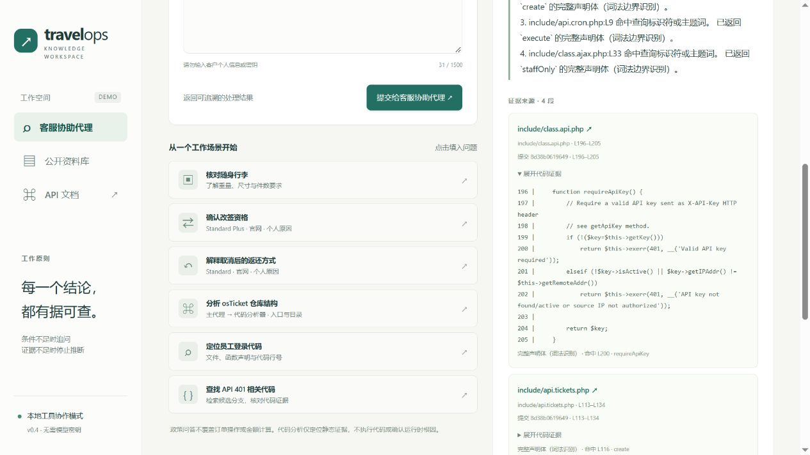

# v0.4 离线版：完整代码片段与可验证检索

这一版不需要模型、API Key 或云服务费用；已有代码索引后，问答不访问网络。新环境安装依赖、下载公开 osTicket 仓库时需要网络。

## 改进的实际问题

以前的代码检索按文件打分，再取命中位置前 3 行起的 18 行。有两个局限：较长函数会被截断；`API 401` 可以选中包含 401 的文件，却因另一个声明得分更高而显示不含 401 的片段。

现在带状态码的搜索将展示位置约束在状态码命中行。随后从命中行出发，尝试识别最小的外围 PHP 命名函数或类，优先返回完整声明体。

例如固定提交中的 `include/class.api.php`：`requireApiKey` 为 L196–L205。查询 `osTicket API 401` 可以核对整个函数的检查分支，而不是截断后的几行。它仍然只说明源码，不据此断定真实生产故障根因。

## 输出完整性

代码引用新增字段：

| 字段 | 含义 |
|---|---|
| `context_kind` | `complete_symbol` 完整声明体、`partial_symbol` 部分声明体、`line_window` 按行窗口 |
| `matched_line` | 此次片段围绕的目标/命中行，必须位于实际返回范围内 |
| `symbol_name` | 能识别边界时的声明名称 |
| `symbol_line_start` / `symbol_line_end` | 能识别时的整个声明范围；可能大于当前片段范围 |

UI 展示完整性标签，并为每行代码加上真实行号；JSON 的 `evidence` 仍然保留索引原文，不插入行号或省略号。

- 声明体读取最多 80 行、12000 个字符，始终包含目标行。超出预算返回连续的整行片段，标记 `partial_symbol`。
- 边界识别仅为保守的 PHP 词法扫描：屏蔽字符串与注释后配对花括号，支持多行函数签名、嵌套方法、文件末尾 PHP 结束标签。
- heredoc/nowdoc、属性语法、混合 HTML/PHP、无法配对的花括号及非 PHP 文件暂不做完整边界承诺，退回最多 24 行的窗口。字符预算仍然适用。
- `complete_symbol` 只表示词法扫描识别到的声明范围全部展示；不表示 PHP AST 验证成功、业务上下文齐全、依赖已解析或执行结果已确认。
- 原始 MCP `read_file` 默认仍是 `mode=lines`，最多 24 行；`mode=symbol` 才启用上述逻辑。应用代码分析器使用 symbol 模式，不需要重新建立索引。
- 不存在的文件或超出文件总行数的读取返回 null，不再把错误行号自动改成最后一行。

## 本地展示步骤

在项目根目录启动：

```powershell
.\.venv\Scripts\python.exe -m uvicorn app.main:app --host 127.0.0.1 --port 8000 --log-config logging.json
```

打开 `http://127.0.0.1:8000`，选择代码分析：

1. 问 `osTicket API 返回 401 时，应该查看哪些代码？`。展开 `include/class.api.php`，核对完整 `requireApiKey` 和 L196–L205，再展开代理调用记录查看真实 MCP 流程。
2. 问 `osTicket getApiKey 在哪定义？`。应定位到该函数的 L192–L194，而不是返回整个文件。
3. 问 `osTicket API 599`。应返回 `insufficient_evidence`，而不是套用 401 的答案。
4. 问 `分析 osTicket 源码`。应要求提供具体目标。
5. 切回旅行政策，查询随身行李，确认原流程仍可使用。

用自动化测试展示故障隔离，无需破坏本地索引：

```powershell
.\.venv\Scripts\python.exe -m pytest tests/test_mcp.py -k 'index_failure or transport_failure or total_timeout' -v
```

测试创建临时索引/注入故障，验证 MCP 故障返回 `upstream_error`、有限重试、政策分支仍可回答。

## 评测

```powershell
.\.venv\Scripts\python.exe -m pytest -q
.\.venv\Scripts\python.exe -m evals.run
.\.venv\Scripts\python.exe -m evals.run_code --backend local
.\.venv\Scripts\python.exe -m evals.run_code --backend mcp_stdio
```

真实仓库回归从 12 条扩到 20 条，增加状态码证据、函数名称/范围、改写提问和未知符号。MCP 评测会对每条问题再调用本地后端，比较状态、回答、claims、sources、索引版本等字段，排除耗时、请求 ID、协议记录和后端标识。

报告包含：原文引用核对数、命中行是否可见、片段完整性分布、证据字符数、后端结果一致性和延迟中位数。完整性分布是覆盖情况，不是“准确率”。MCP 延迟包含启动子进程；对照运行耗时不计入 MCP 请求耗时。

本机验证结果：132 项测试通过，政策回归 40/40；本地与 MCP 代码回归各 20/20，后端结果一致性 20/20。40 段证据均匹配原文且包含目标行，其中 19 段识别为完整声明体、21 段为按行窗口。长函数的部分声明体和字符预算由合成测试覆盖。记录保存在 `evals/code-v04-local-baseline.json` 和 `evals/code-v04-mcp-baseline.json`。



这些是人工编写并用于开发的回归题，不是未参与开发的独立测试集，也不衡量任意代码理解或运行时诊断能力。后续新增问题应保留失败记录，再决定是否修改规则。

## 面试中可以解释的取舍

保留相同本地检索引擎，通过 MCP 展示跨进程工具契约；优先确保引用中真的包含命中位置。通过输出完整性字段暴露边界，而不是隐藏代码截断。相比接入付费模型，这些改动可以直接验证，不产生推理费用。
