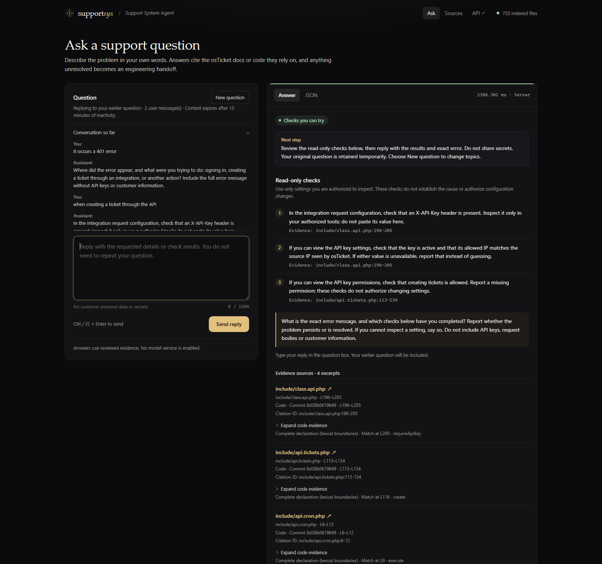

# Three-minute offline demonstration

Audience: a reviewer evaluating the customer-support workflow and engineering design. Use the [quickstart](quickstart.md) with `ENABLE_GEMINI=0` and `CODE_SEARCH_BACKEND=mcp_stdio`. Check that the footer shows v0.12.0. Initial dependency installation and indexing are required; the demonstration itself needs no model key or model API calls.

## 0:00–0:30 — Explain the problem

> Support staff often need engineers to translate a system error into actionable checks. This assistant starts with the support question, retrieves public evidence, and keeps a bounded conversation. It prepares an engineering handoff when the available checks do not resolve the issue.

Show the single question box. The user does not select documentation, code or answer mode.

## 0:30–1:30 — Clarify, retrieve, and offer checks

1. Enter `it occurs a 401 error`.
2. Show the targeted clarification. No tool or model request was needed to ask where it happened.
3. Reply `when creating a ticket through the API` in the same page.
4. Show **Checks you can try** and the three read-only checks. The previous 401 question is retained.
5. Expand one cited code excerpt, then **Engineering details and processing information** and the agent trace.

> The main agent delegated a task to the Code Analyzer. The trace shows actual MCP calls against a pinned repository index. The check instructions are reviewed application rules, gated by exact evidence digests. They are not an LLM diagnosis of the live system.

The JSON should contain `resolution=checks_available`, `conversation.state=awaiting_reply`, `context_used=true`, and `user_turns=2`.

## 1:30–2:10 — Escalate with useful context

For this synthetic demonstration, reply `I checked all three, but it still returns 401.`.

Show **Handoff for additional help** and the download button. The handoff contains the original error, later messages, offered checks, citations and limitations. Nothing is sent automatically. The outcome reply uses cached evidence and deterministic rules, with no new model call.

Alternative branch: choose **New question**, enter `401 error when creating a ticket through the API`, then reply `It works now.`. The system closes the conversation as **user-reported resolution**, without claiming to have verified a fix. Do not submit fictional check results in a real support case.

## 2:10–3:00 — Show scope and optional generation

Choose **New question** between independent examples:

| Question | Demonstrates |
|---|---|
| `Which fields are required to create a ticket through the API?` | Reviewed document summary and version-scoped citations |
| `Which fields are required to create an API ticket in v1.18.2?` | Unsupported-version boundary |
| `What authentication header does the documentation require? Locate the requireApiKey function as well.` | Independent document and code evidence; version alignment is unverified |

> The offline version is fully demonstrable. Gemini can optionally classify unclear intent and synthesize retrieved evidence into an English answer. Its API integration is implemented and mock-tested, and limited live synthesis smoke tests have succeeded. That is not an accuracy benchmark.

Do not enable Gemini merely to complete this offline walkthrough. It remains an operator-controlled integration; see the [Gemini guide](gemini.md).

## Reproducible checks

```powershell
.\.venv\Scripts\python.exe -m scripts.mcp_smoke
.\.venv\Scripts\python.exe -m scripts.try_gemini
.\.venv\Scripts\python.exe -m evals.run_gemini --limit 3
```

The Gemini commands above are dry runs. They validate payloads without reading keys or calling a model. `--live` is an explicit, potentially billable opt-in.

The demo establishes task delegation, real MCP retrieval, source provenance, bounded context and explicit outcomes. It does not establish autonomous reasoning, semantic search, measured support-cost reductions, verified production fixes or production readiness.


